# RentSafe – Rental Security Deposit Escrow DApp

**Course:** Blockchain Technology (CSE4444) – Assignment 2
**Student:** **[FILL IN: Name]** · **Registration No.:** **[FILL IN]**

RentSafe is a decentralized application (DApp) built with Solidity, Ethers.js and MetaMask. A tenant's rental security deposit is locked in an Ethereum smart contract instead of being handed to the landlord. At the end of the lease, the landlord must propose the refund on-chain and give a written reason for any deduction. The tenant can accept it or raise a dispute, and a neutral arbiter settles disputes. Every step is recorded on the blockchain and cannot be changed later.

---

## Contents

1. [Problem addressed](#1-problem-addressed)
2. [How RentSafe solves it](#2-how-rentsafe-solves-it)
3. [Assignment requirements checklist](#3-assignment-requirements-checklist)
4. [Repository structure](#4-repository-structure)
5. [Smart contract design](#5-smart-contract-design)
6. [Steps to execute the application](#6-steps-to-execute-the-application)
7. [Connecting MetaMask and interacting with the contract](#7-connecting-metamask-and-interacting-with-the-contract)
8. [Deployment network and contract address](#8-deployment-network-and-contract-address)
9. [Test cases and observed results](#9-test-cases-and-observed-results)
10. [Screenshots](#10-screenshots)
11. [Security notes](#11-security-notes)
12. [Troubleshooting](#12-troubleshooting)

---

## 1. Problem addressed

Renting a flat or a room usually requires a security deposit of one or more months' rent. Disputes over getting that deposit back are very common, especially for students and young professionals who move often:

- **The landlord holds the money** and alone decides how much to return, so the tenant has no leverage.
- **Deductions are often unexplained** ("cleaning charges", "damages") and there is no record of what was agreed.
- **Refunds are delayed** for weeks or months, or never paid.
- **Going to court or a rent authority** costs more time and money than the deposit is worth, so most tenants give up.

The root cause is trust: one party controls the money, and there is no tamper-proof record of the agreement or of the deductions.

## 2. How RentSafe solves it

The deposit is held by a smart contract that neither party controls. The contract enforces these rules:

| Step | Who | What happens on-chain |
|---|---|---|
| 1. Create agreement | Landlord | Records tenant address, deposit amount, lease end date and property details |
| 2. Pay deposit | Tenant | The exact deposit amount is locked in the contract (escrow) |
| 3. Propose refund | Landlord, **after the lease ends** | Proposes how much to keep; any deduction **must** include a written reason |
| 4a. Accept refund | Tenant | The deposit is split as proposed |
| 4b. Raise dispute | Landlord or tenant, after the lease ends | The agreement is escalated to the arbiter. The tenant can do this even if the landlord never proposes a refund |
| 5. Resolve dispute | Arbiter (the contract deployer) | Decides how much of the deposit goes back to the tenant |
| 6. Withdraw | Landlord / tenant | Each party withdraws the ETH credited to them |

A landlord may also **cancel** an agreement before the deposit is paid.

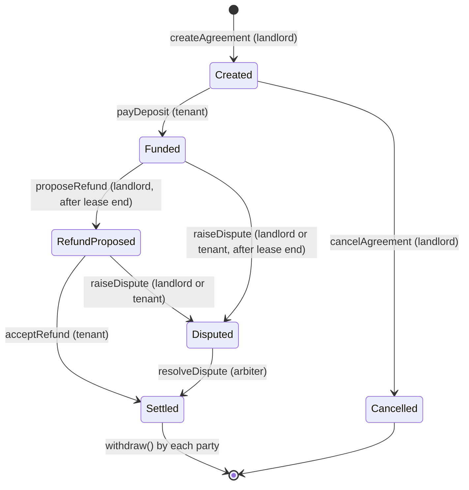

**Roles**

| Role | Account | Can do |
|---|---|---|
| Arbiter | Account that deployed the contract | Resolve disputes, change the minimum deposit. Cannot be a landlord or tenant (no conflict of interest) |
| Landlord | Any account that creates an agreement | Create, cancel, propose refund, raise dispute, withdraw |
| Tenant | Address named in the agreement | Pay deposit, accept refund, raise dispute, withdraw |
| Outsider | Any other account | Read data only. Every write action is rejected |

## 3. Assignment requirements checklist

| Requirement | Where it is met |
|---|---|
| i. Solidity smart contract with suitable variables, functions, a constructor and validation | [`contracts/RentSafe.sol`](contracts/RentSafe.sol): a struct, an enum, 6 state variables and 3 mappings; a constructor that takes the platform name and minimum deposit; 9 transaction functions and 3 view functions; 29 `require` checks (4 of them in access-control modifiers); 8 events |
| ii. Simple frontend using HTML, CSS and JavaScript | [`frontend/index.html`](frontend/index.html), [`frontend/style.css`](frontend/style.css), [`frontend/app.js`](frontend/app.js) |
| iii. MetaMask connection using Web3.js or Ethers.js | Ethers.js v6 `BrowserProvider` + `window.ethereum`, with account/network change handling ([`frontend/app.js`](frontend/app.js)) |
| iv. Successful execution of transactions and retrieval of blockchain data | All actions are sent as MetaMask transactions. The UI reads contract state, agreements, balances and event history from the chain |
| v. Testing with valid, invalid and unauthorised inputs | 42 automated tests ([`test/RentSafe.test.js`](test/RentSafe.test.js), results in [`test-results/`](test-results/automated-test-results.txt)) and the test-case tables in [section 9](#9-test-cases-and-observed-results) |
| Compiled, deployed and tested with Remix IDE + Ganache | [Section 6](#6-steps-to-execute-the-application), [`deployment/DEPLOYMENT.md`](deployment/DEPLOYMENT.md) and [screenshots](#10-screenshots) |

## 4. Repository structure

```
RentSafe-DApp/
├── contracts/
│   └── RentSafe.sol                 # Solidity smart contract
├── frontend/
│   ├── index.html                   # User interface
│   ├── style.css                    # Styling
│   ├── app.js                       # MetaMask + Ethers.js logic
│   └── config.js                    # Contract address, chain ID and ABI
├── test/
│   └── RentSafe.test.js             # 42 automated tests (valid / invalid / unauthorised)
├── test-results/
│   └── automated-test-results.txt   # Output of the test run, with gas report
├── deployment/
│   ├── DEPLOYMENT.md                # Network, address, tx hashes, accounts
│   └── RentSafe.abi.json            # Compiled ABI
├── screenshots/                     # Evidence screenshots (see screenshots/README.md)
├── hardhat.config.js                # Used only to run the automated tests
├── package.json
└── README.md
```

## 5. Smart contract design

**File:** [`contracts/RentSafe.sol`](contracts/RentSafe.sol) · **Solidity** `0.8.19` · **License** MIT

### State variables

| Variable | Type | Purpose |
|---|---|---|
| `arbiter` | `address` (immutable) | Deployer; resolves disputes |
| `platformName` | `string` | Name set in the constructor |
| `minDeposit` | `uint256` | Smallest allowed deposit (wei) |
| `agreementCount` | `uint256` | Number of agreements; also the last ID |
| `totalInEscrow` | `uint256` | ETH currently locked for active agreements |
| `MAX_TEXT_LENGTH` | `uint256` (constant) | 200-byte limit for text fields |
| `agreements` | `mapping(uint256 => Agreement)` | Agreement data by ID |
| `agreementIdsOf` | `mapping(address => uint256[])` | Agreement IDs per landlord/tenant |
| `pendingWithdrawals` | `mapping(address => uint256)` | ETH credited to each party after settlement |

`Agreement` struct: `id, landlord, tenant, deposit, leaseEnd, createdAt, propertyDetails, deduction, deductionReason, tenantRefund, status`.
`Status` enum: `Created, Funded, RefundProposed, Disputed, Settled, Cancelled`.

### Constructor

```solidity
constructor(string memory _platformName, uint256 _minDeposit)
```
Sets the deployer as `arbiter`. Rejects an empty platform name and a zero minimum deposit.

### Functions

| Function | Caller | Validation |
|---|---|---|
| `createAgreement(tenant, deposit, leaseEnd, propertyDetails)` | Landlord | tenant ≠ 0x0, tenant ≠ landlord, neither party is the arbiter, deposit ≥ minimum, lease end in the future, details 1–200 bytes |
| `payDeposit(id)` *payable* | Tenant only | agreement exists, status `Created`, `msg.value` = deposit |
| `cancelAgreement(id)` | Landlord only | status `Created` |
| `proposeRefund(id, deduction, reason)` | Landlord only | status `Funded`, lease ended, deduction ≤ deposit, reason required if deduction > 0, reason ≤ 200 bytes |
| `acceptRefund(id)` | Tenant only | status `RefundProposed` |
| `raiseDispute(id)` | Landlord or tenant | status `Funded` or `RefundProposed`, lease ended |
| `resolveDispute(id, tenantRefund)` | Arbiter only | status `Disputed`, refund ≤ deposit |
| `withdraw()` | Anyone with a balance | balance > 0 |
| `setMinDeposit(amount)` | Arbiter only | amount > 0 |
| `getAgreement(id)` *view* | Anyone | agreement exists |
| `getAgreementIdsOf(address)` *view* | Anyone | – |
| `getContractBalance()` *view* | Anyone | – |

**Events:** `AgreementCreated`, `DepositPaid`, `AgreementCancelled`, `RefundProposed`, `DisputeRaised`, `AgreementSettled`, `Withdrawn`, `MinDepositUpdated`.

## 6. Steps to execute the application

### 6.1 Prerequisites

- Google Chrome, Edge, Brave or Firefox with the **MetaMask** extension installed
- **Ganache**: either the desktop app (GUI) or the CLI via `npx ganache`
- **Node.js 18+** (only for serving the frontend with `npm start` and running the automated tests)
- Internet access for [Remix IDE](https://remix.ethereum.org) and the Ethers.js CDN

### 6.2 Start Ganache

- **Ganache GUI:** open Ganache → **Quickstart (Ethereum)**. The RPC server is `HTTP://127.0.0.1:7545` and the chain ID is `1337`. Ten accounts with 100 ETH each are created.
- **Ganache CLI (alternative):** `npx ganache --chain.chainId 1337 --server.port 7545`

### 6.3 Set up MetaMask

1. MetaMask → network selector → **Add a custom network** (or *Settings → Networks → Add network manually*):
   - Network name: `Ganache Local`
   - RPC URL: `http://127.0.0.1:7545`
   - Chain ID: `1337`
   - Currency symbol: `ETH`
2. Import four Ganache accounts. In Ganache, click the key icon next to an account and copy its private key. In MetaMask, open the account menu → **Add account → Import account** and paste the key. Rename them **Arbiter** (Ganache account 0), **Landlord** (1), **Tenant** (2) and **Outsider** (3).

> These are throw-away Ganache test keys. Never paste them into any file in this repository, and never import a real wallet's keys for testing.

### 6.4 Compile in Remix IDE

1. Open <https://remix.ethereum.org> (it now redirects to `app.remix.live`). In **File Explorer**, right-click `contracts` → **New File** → `RentSafe.sol`, and paste the contents of [`contracts/RentSafe.sol`](contracts/RentSafe.sol).
2. Open the **Solidity Compiler** tab and select compiler **`0.8.19+commit.7dd6d404`**.
   If you use a newer 0.8.x compiler, open *Advanced Configurations* and set **EVM version = `paris`**, because Ganache cannot run the `PUSH0` opcode used by newer EVM versions.
3. Click **Compile RentSafe.sol**. A green tick appears on the compiler icon. → *Screenshot 1*

### 6.5 Deploy to Ganache from Remix

1. Open the **Deploy & Run Transactions** tab.
2. **Environment:** *Browser Extension* → *MetaMask* (in older Remix versions this is one option called *Injected Provider - MetaMask*). Approve the connection in MetaMask with the **Arbiter** account selected. Remix then shows the Arbiter address with its ETH balance; it labels chain 1337 as *Geth Testnet (1337)*.
   (Alternative: *Custom - External Http Provider* with `http://127.0.0.1:7545`.)
3. **Contract:** `RentSafe`. Switch off **Verify Contract on Explorers**, because a local chain has no block explorer.
4. Enter the constructor arguments:
   - `_platformName`: `RentSafe Escrow`
   - `_minDeposit`: `10000000000000000` (0.01 ETH in wei)
5. Click **Deploy** and confirm *Deploy a contract* in MetaMask. The contract appears under **Deployed Contracts** and the terminal shows a green entry. → *Screenshot 2*
6. Copy the **contract address**, and from the terminal entry, the **transaction hash**, **block number** and **gas used**. Put them in [section 8](#8-deployment-network-and-contract-address) and [`deployment/DEPLOYMENT.md`](deployment/DEPLOYMENT.md).

### 6.6 Configure and run the frontend

1. Edit [`frontend/config.js`](frontend/config.js):
   ```js
   CONTRACT_ADDRESS: "0x...your deployed address...",
   CHAIN_ID: 1337,
   DEPLOYMENT_BLOCK: 0,
   EXPLORER_URL: "",
   ```
2. Serve the `frontend` folder over HTTP. MetaMask does not inject into `file://` pages, so double-clicking `index.html` will not work. Use one of:
   ```bash
   npm install
   npm start                          # http://localhost:8080
   # or
   npx http-server frontend -p 8080
   # or
   python -m http.server 8080 --directory frontend
   ```
   The VS Code *Live Server* extension also works.
3. Open <http://localhost:8080> in the browser that has MetaMask.

### 6.7 Run the automated tests (optional)

```bash
npm install
npm test                 # 42 passing
REPORT_GAS=true npm test # with a gas usage table (macOS/Linux/Git Bash)
```

## 7. Connecting MetaMask and interacting with the contract

### Connect

1. Select the **Ganache Local** network in MetaMask.
2. Click **Connect MetaMask** in the top-right corner of the DApp. In the MetaMask pop-up, **select all four test accounts** (Arbiter, Landlord, Tenant, Outsider) and click *Connect*. → *Screenshot 3*
3. The header shows *Ganache · 1337* and the connected address. *Your account* shows the address, ETH balance, role and withdrawable balance. *Contract on the blockchain* shows data read from the contract.
4. To act as a different person, switch accounts in MetaMask. The page updates automatically.

### Walk-through (complete lifecycle)

| # | MetaMask account | Action in the DApp | Result |
|---|---|---|---|
| 1 | Landlord | **1. Create an agreement**: tenant = Tenant's address, deposit `1`, lease end **+2 min (demo)**, property `Flat 203, Green Residency, Manipal` → *Create agreement* → confirm | Agreement #1 appears with status **Created** |
| 2 | Tenant | **2. Manage an agreement** (loads automatically, or click the row) → *Pay deposit* (1 ETH) → confirm | Status **Funded**, *ETH in escrow* = 1 ETH → *Screenshot 4* |
| 3 | Outsider | *Pay deposit* | Rejected: *Only the tenant can perform this action* → *Screenshot 5* |
| 4 | Landlord | Wait until the lease end has passed (the hint turns green), then *Propose refund*: deduction `0.2`, reason `Broken window` | Status **Refund proposed** |
| 5a | Tenant | *Accept refund* | Status **Settled**: tenant 0.8 ETH, landlord 0.2 ETH credited |
| 5b | Tenant → Arbiter | *(alternative)* Tenant: *Raise dispute*. Then Arbiter: *Resolve dispute* with refund `0.9` | Status **Settled**: tenant 0.9 ETH, landlord 0.1 ETH |
| 6 | Tenant, Landlord | *Withdraw my ETH* in *Your account* | ETH arrives in the MetaMask wallet |

The **Agreements stored on the blockchain** table, the **Contract event history** (read from contract logs) and the stat tiles show the on-chain data. → *Screenshot 6*

Each action card shows a hint before you send. **✓ You can do this now** means the transaction should succeed. **✗ Expected to be rejected: …** means it should fail. The button stays clickable so that invalid and unauthorised inputs can be tested against the contract. The **Transaction log** records every attempt with its status, revert reason, transaction hash, block number and gas used.

**Recording a failed transaction on-chain.** Normally Ethers.js simulates a transaction first, and if it would revert, it is stopped before MetaMask sends it. Under *Platform settings → Testing option*, tick **Send transactions even if they are expected to fail**. The transaction is then sent with a fixed gas limit, mined, and fails with status 0. It appears as a failed transaction in MetaMask and Ganache, and the DApp shows the revert reason.

### Interacting directly in Remix (alternative)

Under **Deployed Contracts**, expand the RentSafe instance:
- **Read:** `platformName`, `arbiter`, `minDeposit`, `agreementCount`, `totalInEscrow`, `getAgreement(1)`, `getAgreementIdsOf(<address>)`, `pendingWithdrawals(<address>)`
- **Write:** select the right account in MetaMask, then call e.g. `createAgreement`. `leaseEnd` is a Unix timestamp in seconds; in the browser console, `Math.floor(Date.now()/1000) + 120` gives "2 minutes from now".
- **payDeposit:** set **VALUE** to `1` and the unit to **Ether** above the Deploy button before clicking `payDeposit`.
- **Failing call:** Remix shows *Gas estimation failed*. Through MetaMask the message may read *missing revert data* rather than the reason (the DApp extracts the reason from the same error). Clicking **Send Transaction** mines the failing transaction, which Remix then lists as *0 Transaction mined but execution failed* (see [screenshot 8](#10-screenshots)).

## 8. Deployment network and contract address

| Item | Value |
|---|---|
| Network | **Ganache** local Ethereum blockchain (`http://127.0.0.1:7545`) |
| Chain ID | `1337` |
| Deployed with | Remix IDE 2.6.7 → *Browser Extension → MetaMask* (MetaMask 13.50.0) |
| Compiler | Solidity `0.8.19+commit.7dd6d404`, EVM `paris`, optimizer off |
| Constructor arguments | `"RentSafe Escrow"`, `10000000000000000` (0.01 ETH) |
| **Contract address** | **`0x5FbDB2315678afecb367f032d93F642f64180aa3`** |
| Deployer / arbiter | `0xf39Fd6e51aad88F6F4ce6aB8827279cffFb92266` |
| Deployment transaction hash | `0xf5270195fd0c9ac09631228523b0536b1618b9b7dae2977f5efca0ccbd1f0d37` (block 1, 3,319,349 gas) |

Full details and the transaction evidence table are in [`deployment/DEPLOYMENT.md`](deployment/DEPLOYMENT.md).

> Ganache is a local blockchain, so the address above exists only on the machine where Ganache is running. If Ganache is restarted with a new workspace, redeploy and update `frontend/config.js`.

## 9. Test cases and observed results

Testing was done at three levels:

1. **Automated contract tests:** 42 Hardhat/Mocha tests in [`test/RentSafe.test.js`](test/RentSafe.test.js). **All 42 pass**; the full output with a gas report is in [`test-results/automated-test-results.txt`](test-results/automated-test-results.txt).
2. **Manual tests in Remix IDE on Ganache** with the four MetaMask accounts.
3. **Manual tests through the DApp UI** with MetaMask.

The test IDs below are the same as in the automated test file. The *Observed result* column is the actual output of the contract: the revert reasons are the exact strings returned, which Remix shows in its terminal and the DApp shows in its transaction log.

### 9.1 Constructor (deployment) tests

| ID | Input | Expected | Observed result |
|---|---|---|---|
| D-01 | `("RentSafe Escrow", 10000000000000000)` from Arbiter | Deploys; `arbiter` = deployer, `minDeposit` = 0.01 ETH | ✅ Deployed; getters return the deployer, `RentSafe Escrow`, 0.01 ETH, 0 agreements |
| D-02 | `("", 10000000000000000)` | Deployment rejected | ✅ Reverted: `Platform name is required` |
| D-03 | `("RentSafe Escrow", 0)` | Deployment rejected | ✅ Reverted: `Minimum deposit must be greater than zero` |

### 9.2 Valid inputs

| ID | Account | Input | Expected | Observed result |
|---|---|---|---|---|
| V-01 | Landlord | `createAgreement(Tenant, 1 ETH, now+30 days, "Flat 203, Green Residency, Manipal")` | Agreement #1 stored with status Created | ✅ Success; `AgreementCreated(1, …)` emitted; `agreementCount` = 1; gas ≈ 343,867 |
| V-02 | Tenant | `payDeposit(1)` with 1 ETH | Status Funded; 1 ETH held in escrow | ✅ Success; status Funded; `totalInEscrow` = 1 ETH; tenant −1 ETH, contract +1 ETH; gas 74,947 |
| V-03 | Landlord | `cancelAgreement(1)` before payment | Status Cancelled | ✅ Success; `AgreementCancelled` emitted |
| V-04 | Landlord | `proposeRefund(1, 0.2 ETH, "Broken window")` after the lease ends | Status RefundProposed | ✅ Success; deduction 0.2 ETH and reason stored |
| V-05 | Landlord | `proposeRefund(1, 0, "")` | Full refund allowed without a reason | ✅ Success |
| V-06 | Tenant | `acceptRefund(1)` | Settled; tenant 0.8 ETH, landlord 0.2 ETH credited | ✅ Success; `AgreementSettled(1, 0.8, 0.2, false)`; escrow back to 0 |
| V-07 | Tenant, Landlord | `withdraw()` | ETH sent to each wallet | ✅ Tenant +0.8 ETH, landlord +0.2 ETH, contract balance 0 |
| V-08 | Tenant | `raiseDispute(1)` after a proposal | Status Disputed | ✅ Success; `DisputeRaised(1, Tenant)` |
| V-09 | Landlord | `raiseDispute(1)` after lease end, no proposal | Status Disputed | ✅ Success |
| V-10 | Arbiter | `resolveDispute(1, 0.9 ETH)` | Settled; tenant 0.9, landlord 0.1 ETH | ✅ Success; `AgreementSettled(1, 0.9, 0.1, true)`; gas 108,303 |
| V-11 | Arbiter | `setMinDeposit(0.05 ETH)` | Minimum updated | ✅ Success; `MinDepositUpdated(0.01, 0.05)` |
| V-12 | Anyone | `getAgreementIdsOf(address)` | IDs per user | ✅ Landlord `[1, 2]`, Tenant `[1]`, Outsider `[2]` |

### 9.3 Invalid inputs

| ID | Account | Input | Expected | Observed result |
|---|---|---|---|---|
| I-01 | Landlord | tenant = `0x0000…0000` | Rejected | ✅ Reverted: `Tenant address cannot be zero` |
| I-02 | Landlord | tenant = the landlord's own address | Rejected | ✅ Reverted: `Landlord and tenant must be different` |
| I-03 | Landlord | deposit 0.001 ETH (minimum is 0.01) | Rejected | ✅ Reverted: `Deposit is below the minimum` |
| I-04 | Landlord | lease end in the past | Rejected | ✅ Reverted: `Lease end must be in the future` |
| I-05 | Landlord | property details empty / 201 characters | Rejected | ✅ Reverted: `Property details must be 1-200 characters` |
| I-06 | Tenant | `payDeposit(1)` with 0.5 ETH (deposit is 1 ETH) | Rejected | ✅ Reverted: `Sent amount must equal the deposit` |
| I-07 | Tenant | `payDeposit(1)` a second time | Rejected | ✅ Reverted: `Deposit already paid or agreement closed` |
| I-08 | Any | agreement ID `0` or `99` | Rejected | ✅ Reverted: `Agreement does not exist` |
| I-09 | Landlord | `cancelAgreement(1)` after payment | Rejected | ✅ Reverted: `Only unpaid agreements can be cancelled` |
| I-10 | Landlord | `proposeRefund` before the lease end | Rejected | ✅ Reverted: `Lease has not ended yet` |
| I-11 | Landlord | deduction 2 ETH on a 1 ETH deposit | Rejected | ✅ Reverted: `Deduction cannot exceed the deposit` |
| I-12 | Landlord | deduction 0.1 ETH with an empty reason | Rejected | ✅ Reverted: `A reason is required for any deduction` |
| I-13 | Tenant | `acceptRefund` with no proposal | Rejected | ✅ Reverted: `There is no refund proposal to accept` |
| I-14 | Tenant | `raiseDispute` before the lease end | Rejected | ✅ Reverted: `Lease has not ended yet` |
| I-15 | Arbiter | `resolveDispute(1, 1.5 ETH)` | Rejected | ✅ Reverted: `Refund cannot exceed the deposit` |
| I-16 | Arbiter | `resolveDispute` on an agreement that is not disputed | Rejected | ✅ Reverted: `Agreement is not under dispute` |
| I-17 | Tenant | `withdraw()` with nothing owed | Rejected | ✅ Reverted: `Nothing to withdraw` |
| I-18 | Arbiter | `setMinDeposit(0)` | Rejected | ✅ Reverted: `Minimum deposit must be greater than zero` |
| I-19 | Outsider | plain ETH transfer to the contract address | Rejected | ✅ Reverted (the contract has no `receive`/`fallback` function) |

Frontend input validation. These inputs are caught in the browser before any transaction is created:

| ID | Input in the DApp | Expected | Observed result |
|---|---|---|---|
| F-01 | Tenant address `0x123` | Blocked with a message | ✅ "Tenant address must be a valid Ethereum address (0x followed by 40 hex characters)." |
| F-02 | Deposit `-5` or `abc` | Blocked with a message | ✅ "Security deposit must be a positive number of ETH, e.g. 0.5" |
| F-03 | Agreement ID `abc` | Blocked with a message | ✅ "Agreement ID must be a whole number, e.g. 1" |

### 9.4 Unauthorised inputs

| ID | Account (not allowed) | Action | Expected | Observed result |
|---|---|---|---|---|
| U-01 | Outsider | `payDeposit(1)` with 1 ETH | Rejected | ✅ Reverted: `Only the tenant can perform this action` |
| U-02 | Tenant | `cancelAgreement(1)` | Rejected | ✅ Reverted: `Only the landlord can perform this action` |
| U-03 | Tenant | `proposeRefund(1, 0, "")` | Rejected | ✅ Reverted: `Only the landlord can perform this action` |
| U-04 | Landlord | `acceptRefund(1)` | Rejected | ✅ Reverted: `Only the tenant can perform this action` |
| U-05 | Outsider | `raiseDispute(1)` | Rejected | ✅ Reverted: `Only the landlord or tenant can raise a dispute` |
| U-06 | Landlord | `resolveDispute(1, 0)` | Rejected | ✅ Reverted: `Only the arbiter can perform this action` |
| U-07 | Outsider | `setMinDeposit(1)` | Rejected | ✅ Reverted: `Only the arbiter can perform this action` |
| U-08 | Arbiter | `createAgreement(…)` as landlord, or named as tenant | Rejected | ✅ Reverted: `Arbiter cannot be a party to an agreement` |

In every rejected case the contract state is unchanged. A transaction that is mined anyway (forced send) is recorded with status 0, and its gas is still charged.

### 9.5 Manual test run on Ganache through MetaMask

The deployed contract was then exercised end to end through Remix and the DApp, with every transaction signed in MetaMask (16 Oct 2026). Transaction hashes for every row are in [`deployment/DEPLOYMENT.md`](deployment/DEPLOYMENT.md#transaction-evidence).

| Test ID | Account | Action | Observed result |
|---|---|---|---|
| D-01 | Arbiter | Deploy from Remix | ✅ Block 1: contract `0x5FbD…0aa3` created |
| I-18 | Arbiter | Remix: `setMinDeposit(0)`, forced send | ✅ Block 2: mined but **failed** (status 0) |
| I-03 | Landlord | DApp: create with deposit 0.001 ETH | ✅ Rejected: `Deposit is below the minimum` |
| V-01 | Landlord | DApp: create agreement #1 (1 ETH, lease +2 min) | ✅ Block 3: success |
| I-06 | Tenant | DApp: pay 0.5 ETH | ✅ Rejected: `Sent amount must equal the deposit` |
| V-02 | Tenant | DApp: pay 1 ETH | ✅ Block 4: success, status *Funded* |
| I-10 | Landlord | DApp: propose refund before the lease end | ✅ Rejected: `Lease has not ended yet` |
| U-01 | Outsider | DApp: pay deposit | ✅ Rejected: `Only the tenant can perform this action` |
| U-01 | Outsider | DApp: pay deposit, forced send | ✅ Block 5: mined but **failed** (status 0); MetaMask shows *Interaction failed* |
| U-05 | Outsider | DApp: raise dispute | ✅ Rejected: `Only the landlord or tenant can raise a dispute` |
| V-04 | Landlord | DApp: propose refund 0.2 ETH, "Broken window" | ✅ Block 6: success |
| V-08 | Tenant | DApp: raise dispute | ✅ Block 7: success, status *Disputed* |
| U-06 | Landlord | DApp: resolve dispute | ✅ Rejected: `Only the arbiter can perform this action` |
| I-15 | Arbiter | DApp: resolve with 1.5 ETH | ✅ Rejected: `Refund cannot exceed the deposit` |
| V-10 | Arbiter | DApp: resolve with 0.9 ETH | ✅ Block 8: success, *Settled*: tenant 0.9 ETH, landlord 0.1 ETH |
| V-07 | Tenant | DApp: withdraw | ✅ Block 9: 0.9 ETH received |
| I-17 | Tenant | DApp: withdraw again | ✅ Rejected: `Nothing to withdraw` |
| V-07 | Landlord | DApp: withdraw | ✅ Block 10: 0.1 ETH received; contract balance 0 ETH |

## 10. Screenshots

All screenshots are in [`screenshots/`](screenshots/). They were captured during the run described in [section 9.5](#95-manual-test-run-on-ganache-through-metamask).

### 1. Smart contract compilation (Remix IDE)
Solidity compiler `0.8.19+commit.7dd6d404`, contract `RentSafe (RentSafe.sol)`, green tick on the compiler icon.
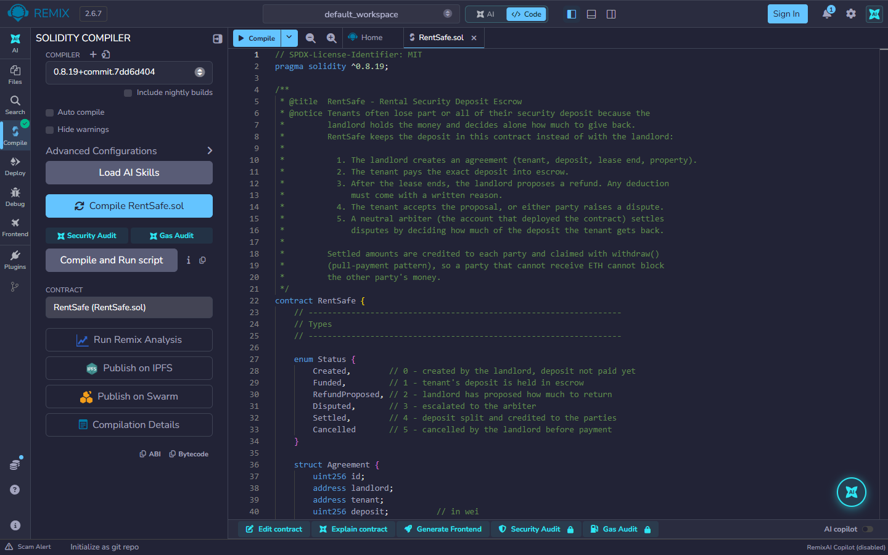

### 2. Smart contract deployment (Remix → MetaMask → Ganache)
The Remix terminal shows the mined deployment: transaction hash, block 1, contract address, 3,319,349 gas, and the decoded constructor input.
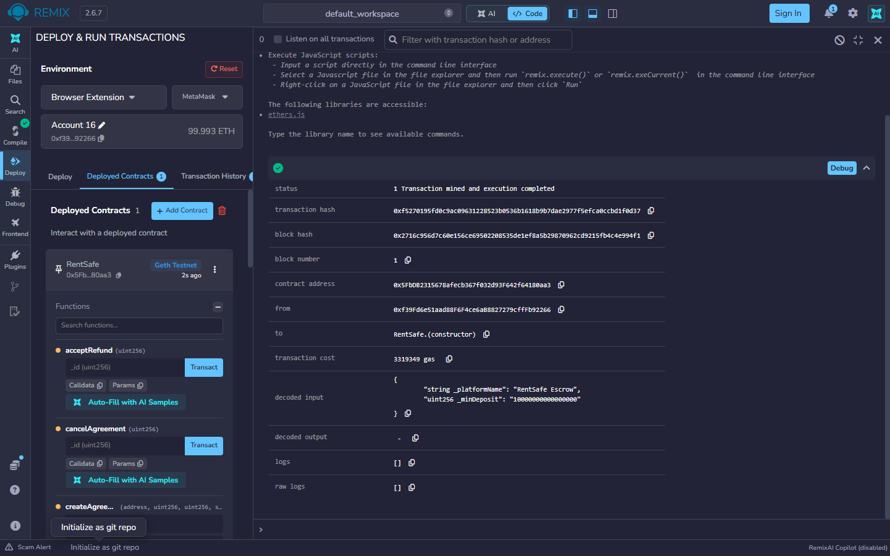

The MetaMask *Deploy a contract* confirmation on the *Ganache Local* network:
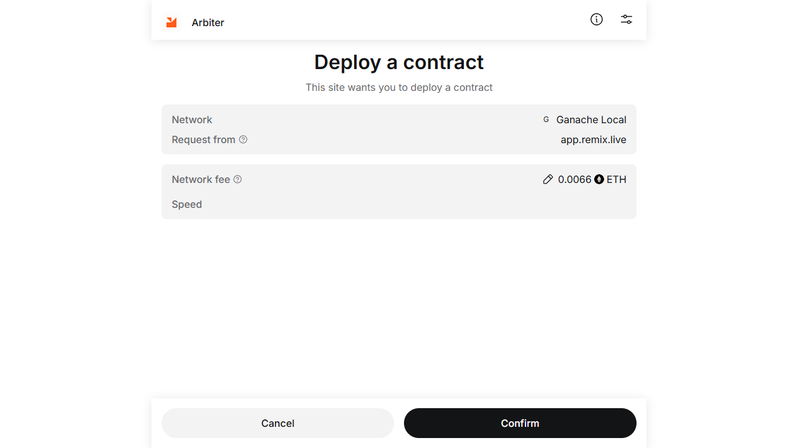

### 3. MetaMask wallet connection
The DApp connected through MetaMask: the header shows *Ganache · 1337* and the Landlord account.
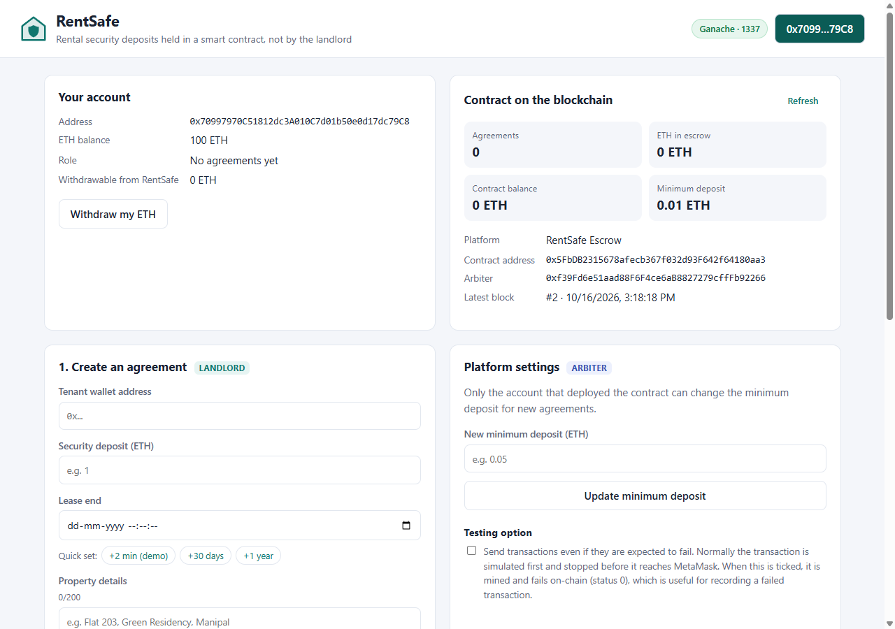

The MetaMask connection request from `localhost`:
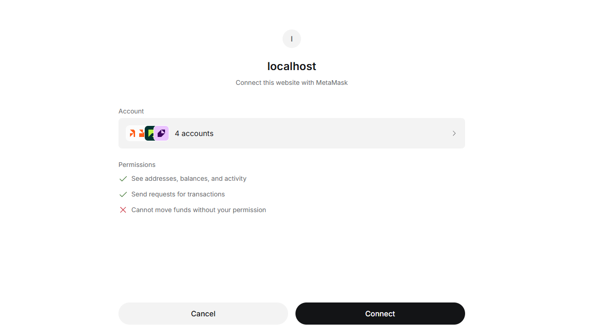

### 4. Successful transaction
*Pay deposit (#1)* confirmed in block 4, together with the rejected invalid attempts around it.
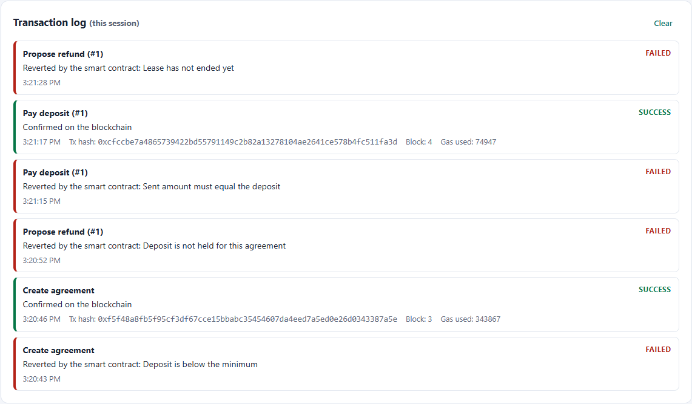

The MetaMask confirmation for the 1 ETH deposit:
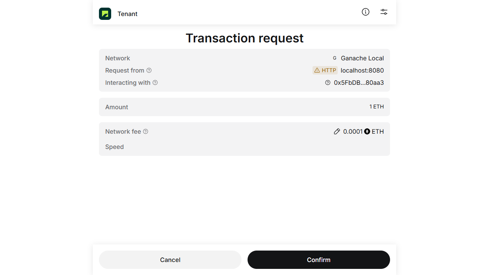

### 5. Failed transaction
Unauthorised and invalid attempts rejected by the contract. The forced *Pay deposit* by the Outsider was mined in block 5 and failed with status 0.
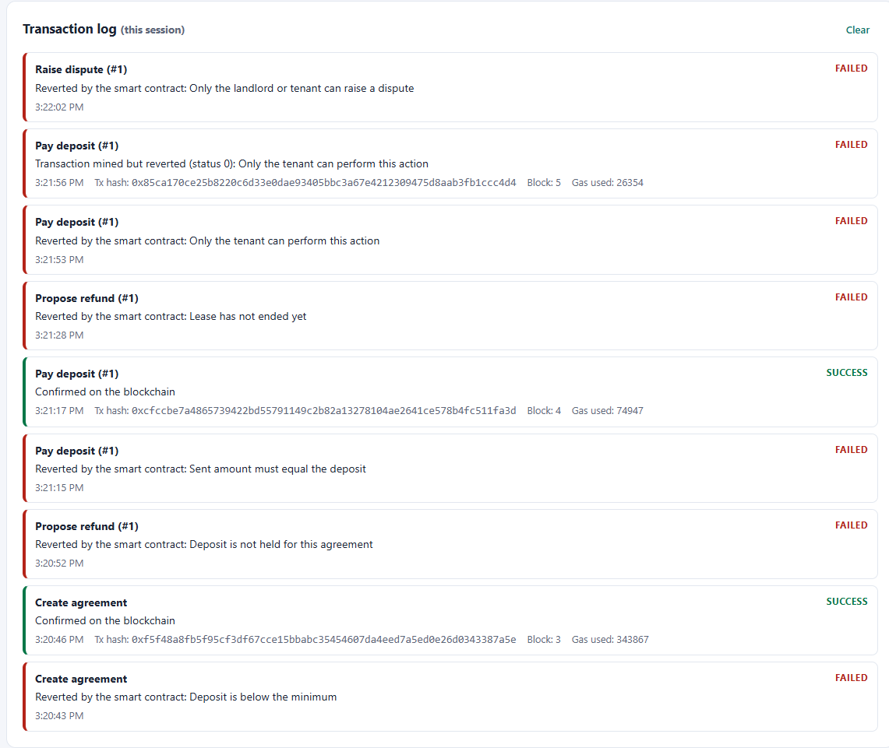

MetaMask's activity list for the Outsider shows *Interaction failed*:
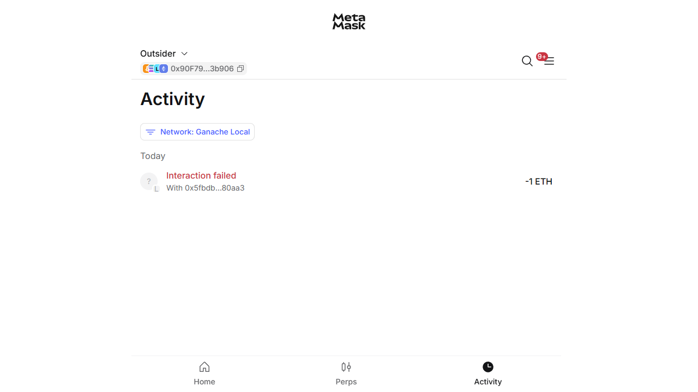

### 6. Blockchain data displayed through the user interface
Contract statistics, the settled agreement with its split, the transaction log and the event history are all read from the chain.
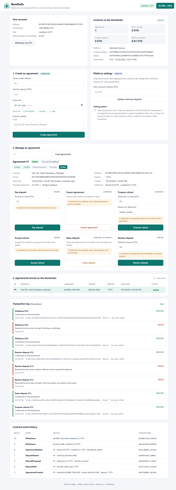

### Extra: invalid input rejected in Remix
`setMinDeposit(0)` from the Arbiter: *0 Transaction mined but execution failed*.
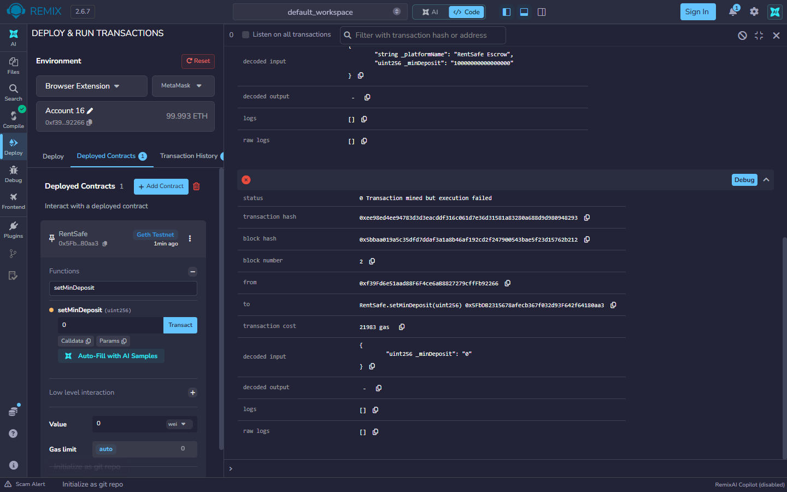

## 11. Security notes

- **Pull payments:** settlement only credits balances, and each party withdraws separately. A party whose address cannot receive ETH cannot block the other party's refund.
- **Checks-effects-interactions:** `withdraw()` sets the balance to zero before sending ETH, which prevents re-entrancy.
- **Access control** with `onlyArbiter`, `onlyLandlord` and `onlyTenant` modifiers. The arbiter can never be a party to an agreement.
- **Exact-amount deposits** and a **minimum deposit**. Plain ETH transfers are rejected, so funds cannot get stuck outside an agreement.
- **Bounded strings** (≤ 200 bytes) keep gas costs predictable.
- Solidity 0.8.x checks arithmetic for overflow and underflow.
- **No secrets in this repository:** no private keys, seed phrases, passwords or API keys. `.gitignore` excludes `.env` files.

## 12. Troubleshooting

| Problem | Fix |
|---|---|
| *invalid opcode* when deploying to Ganache | Compile with `0.8.19`, or set EVM version to `paris` in Remix's advanced compiler settings |
| DApp says *No contract found at …* | `CONTRACT_ADDRESS` in `config.js` is wrong, MetaMask is on another network, or Ganache was restarted (redeploy) |
| DApp says *MetaMask is on chain X* | Switch MetaMask to *Ganache Local* (chain 1337), or click **Switch network** |
| *Nonce too high* / transactions stuck after restarting Ganache | MetaMask → *Settings → Advanced → Clear activity tab data* |
| MetaMask does not pop up on `index.html` | Serve the folder over `http://localhost` (section 6.6); `file://` pages are not supported |
| Switching account shows "not connected" | In MetaMask, open *Connected sites* and connect that account to `localhost:8080` |
| *Lease has not ended yet* | Wait until the lease end time has passed. Ganache only moves its clock forward when it mines a block, so a call can still see the old time just after the lease ends. The DApp detects this and sends the transaction anyway, and it is mined in a new block with the current time. In Remix, click **Send Transaction** on the *Gas estimation failed* dialog |
